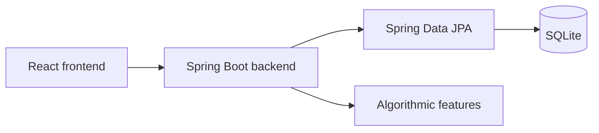

# EduNexus School Management System

A full-stack school management portfolio project built with React, TypeScript and Java Spring Boot. It explores academic analytics and practical applications of graph algorithms.

## Architecture

### Frontend (React + TypeScript)
- **Vite**: Ultra-fast build tool.
- **Lucide React**: For beautiful iconography.
- **Motion (framer-motion)**: For smooth, premium animations.
- **Tailwind CSS**: For modern styling.

### Backend (Java + Spring Boot)
- **Spring Boot 3**: Enterprise-grade Java framework.
- **Spring Data JPA**: For database interaction.
- **SQLite**: Portable database storage.
- **DSA & Algorithms**:
    - **Linear Regression**: Predicts student performance for next terms.
    - **Dijkstra's Algorithm**: Calculates the shortest route between campus buildings.
    - **BFS (Breadth-First Search)**: Maps subject dependencies for learning paths.

## Getting Started

Prerequisites: Node.js and npm, a JDK compatible with the backend Maven configuration, and Maven. Run the frontend and backend in separate terminals.

### 1. Run the Backend
Navigate to the `backend` directory and run:
```bash
mvn spring-boot:run
```
The backend will start on `http://localhost:8081`.

### 2. Run the Frontend
In the root directory, run:
```bash
npm install
npm run dev
```
The frontend will start on `http://localhost:5173`.

## New Features
- **Campus AI (DSA)**: Explore the power of algorithms in school management.
- **Real-time Analytics**: Live stats fetched from the Java backend.
- **Academic Predictions**: AI-driven grade forecasting.

## Architecture at a glance



## Scope and limitations

This is a portfolio demonstration. Grade forecasts are illustrative, not validated educational predictions. Before real school deployment, review authentication, authorization, student privacy, accessibility and backup procedures.
